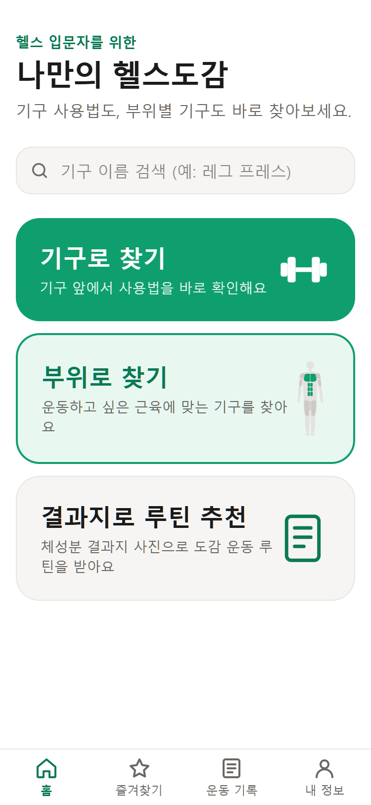
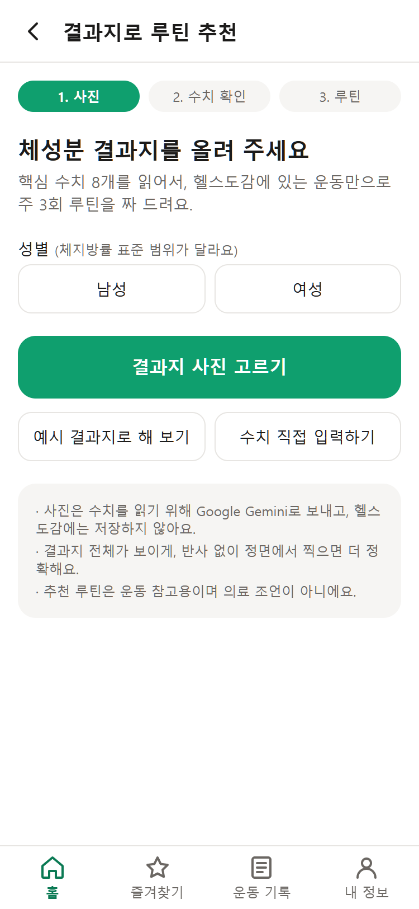
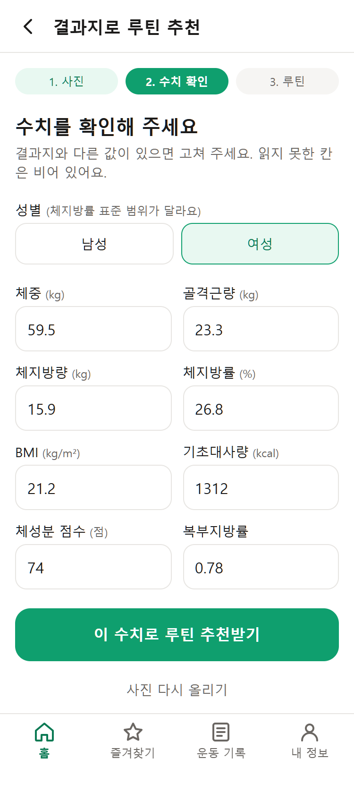
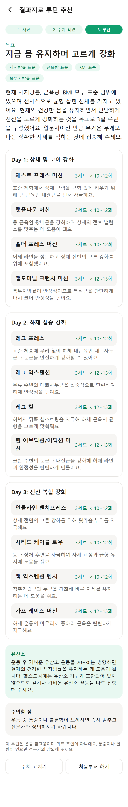

# 체성분 결과지 → 헬스도감 운동 루틴 추천 PoC

헬스장에서 받은 **체성분 결과지 사진 한 장**으로 핵심 수치 8개를 자동으로 읽고, **헬스도감에 있는 운동만으로** 주 3회 루틴을 추천하는 PoC입니다.
AI Agent 서비스 개발자 과정 Main Quest 2 과제이며, Main Quest 1에서 만든 [나만의 헬스도감](https://ai-agent-mainquest1-health.vercel.app)을 확장합니다.

- **바로 써 보기**: https://ai-agent-mainquest1-health.vercel.app/routine → "예시 결과지로 해 보기"
- **헬스도감 저장소**: https://github.com/jsseo0420/ai-agent-mainquest1-health (`app/routine`, `lib/routine`)

> 결과지는 모두 직접 만든 가상 데이터이며, 추천 결과는 의료 조언이 아닙니다.

| 1. 홈 | 2. 사진 올리기 | 3. 수치 확인 | 4. 루틴 |
|---|---|---|---|
|  |  |  |  |

## 1. 문제와 가설

헬스 입문자는 체성분 결과지를 받아도 숫자의 의미를 모르고, 어떤 기구로 운동할지까지 이어지지 않습니다. 수치를 손으로 옮기면 약 2분이 걸리고, 범용 챗봇에 물으면 헬스장에 없거나 도감에 설명이 없는 운동을 추천합니다.

> 결과지 사진으로 수치를 자동 추출하고, 헬스도감에 있는 운동만으로 루틴을 구성하면 입력 시간이 크게 줄고 추천된 모든 운동의 자세를 도감에서 바로 확인할 수 있다.

자세한 내용: [docs/problem_definition.md](docs/problem_definition.md)

## 2. 파이프라인

```
결과지 사진
  → ① 수치 추출 (Gemini Flash 비전, JSON 스키마)        ← 3가지 방식 비교로 선정
  → ② 사용자가 수치 확인·수정 (값끼리 안 맞으면 경고)
  → ③ 코드가 판정 (체지방률·근육량·BMI·복부지방률 → 목표)
  → ④ LLM이 도감 운동 ID 목록 안에서 루틴 구성 (JSON)
  → ⑤ 코드가 도감 밖 운동 제거
  → ⑥ 헬스도감 화면에 표시 (운동마다 도감 상세로 연결)
```

- **건강 수치 해석은 LLM에 맡기지 않습니다.** 판정은 기준표로 코드가 하고, LLM은 운동 구성만 합니다. 같은 수치면 언제나 같은 판정이 나옵니다. ([prompts/routine_guidelines.md](prompts/routine_guidelines.md))
- **도감 밖 운동은 두 번 막습니다.** 프롬프트에 운동 ID 목록을 주고, 응답의 ID를 코드에서 다시 대조합니다.

## 3. 결과 요약

### 수치 추출: 3가지 방식 비교 (가상 결과지 15장, 필드 120개)

| 방식 | 필드 정확도 | 장당 시간 (중앙값) | 비용 | 사진 외부 전송 |
|---|---|---|---|---|
| A. EasyOCR + 규칙 (기준선) | 40.8% | 1.7초 | 0 | 없음 |
| **B. Gemini Flash (선정)** | **100%** | 19.3초 | 0 (무료 등급) | Google |
| C. Qwen2.5-VL 3B (로컬) | 77.5% | 5.5초 | 0 (Colab GPU) | 없음 |

- 흐림·기울기·그림자·저해상도 사진에서 A는 0~69%, C는 56~100%로 떨어졌고, B는 모든 조건에서 100%였습니다.
- OCR 모델(A)은 글자는 읽지만 어느 숫자가 측정값인지 고르는 규칙이 흔들린 사진에서 무너졌고, OCR 능력이 내장된 비전 언어 모델(VLM)인 Gemini(B)는 읽기와 해석을 한 번에 해서 모든 조건에서 100%를 맞혔습니다.
- 선정 근거와 해석: [docs/model_comparison.md](docs/model_comparison.md)

### 루틴 추천: 범용 챗봇식 vs 제안 방식 (15명)

| 방식 | 도감 포함률 | 도감 밖 운동이 섞인 루틴 |
|---|---|---|
| 범용 챗봇식 ("루틴 짜 줘") | 62.4% | 15/15 |
| **제안 방식** | **100%** | **0/15** |

- 범용 챗봇식은 플랭크(15명 중 13명), 바벨 스쿼트, 데드리프트, 덤벨 운동, 트레드밀처럼 도감에서 자세를 확인할 수 없는 운동을 추천했습니다.
- 제안 방식은 루틴 규칙(3일 구성, 하루 4~6개, 2~4세트, 8~15회, 가슴·등·하체 포함, 체지방 높음 → 유산소 안내)을 15명 모두 지켰습니다.

### 성공 기준

| 항목 | 목표 | 결과 |
|---|---|---|
| 핵심 8개 필드 추출 정확도 | 95% 이상 | **100%** 달성 |
| 입력 시간 (사진 → 수치) | 10초 이내 | 중앙값 19.3초로 **미달**. 수기 입력 약 2분보다는 6배 빠름 |
| 추천 운동의 도감 포함률 | 100% | **100%** 달성 (범용 챗봇식 62.4%) |
| 흐린·기울어진 사진 | 하락 폭 측정 | 선정 모델은 하락 없음 |

## 4. 실패 사례

| 사례 | 내용 |
|---|---|
| 1. 막대그래프 숫자를 못 읽음 (Qwen) | 표가 아닌 그래프에만 있는 체지방률을 15장 중 7장에서 비워 냈다 |
| 2. 헷갈리는 숫자에 속음 (Qwen) | 기초대사량 자리에 권장섭취열량을, 골격근량 자리에 체중 표준범위 하한을 넣었다 |
| 3. 기울어진 사진에서 칸 밀림 (EasyOCR) | 체중 칸에 지방조절값, 골격근량 칸에 체중이 들어가는 연쇄 밀림 |
| 4. 목표가 한쪽만 반영됨 (루틴) | "근육량 + 체지방" 복합 목표 6명의 운동 82%가 12회 이상으로, 근육량 기준(8~12회)이 빠졌다 |

틀린 값마다 결과지의 어느 숫자를 가져왔는지까지 대조했습니다. 자세한 내용: [docs/evaluation.md](docs/evaluation.md)

## 5. 실행 방법

### 노트북 (Google Colab)

| 노트북 | 내용 | 런타임 | 걸리는 시간 |
|---|---|---|---|
| [notebooks/poc.ipynb](notebooks/poc.ipynb) [](https://colab.research.google.com/github/jsseo0420/ai-agent-mainquest2-inbody-routine-poc/blob/main/notebooks/poc.ipynb) | 수치 추출 3가지 방식 비교 | T4 GPU | 20분 이상 (모델 내려받기 포함) |
| [notebooks/routine.ipynb](notebooks/routine.ipynb) [](https://colab.research.google.com/github/jsseo0420/ai-agent-mainquest2-inbody-routine-poc/blob/main/notebooks/routine.ipynb) | 루틴 추천 평가 | CPU | 약 10분 |

1. 배지를 눌러 Colab에서 엽니다. `poc.ipynb`는 **런타임 → 런타임 유형 변경 → T4 GPU**로 바꿉니다.
2. 왼쪽 🔑 **Secrets**에 `GEMINI_API_KEY`를 추가하고 **노트북 액세스**를 켭니다. 키는 [Google AI Studio](https://aistudio.google.com/apikey)에서 무료로 만들 수 있습니다.
3. 위에서부터 차례로 실행합니다. 결과는 `results/`에 저장되고, 다시 실행하면 실패한 것만 다시 부릅니다.

- 무료 등급 한도(분당 5회) 때문에 호출 사이에 13초씩 쉬고, 429·503 오류는 기다렸다가 자동으로 다시 시도합니다.
- Gemini 모델은 자주 바뀌고 혼잡할 때가 많습니다. 404나 긴 지연이 나면 셀이 보여 주는 "사용 가능한 Flash 모델" 중 하나로 `GEMINI_MODEL`을 바꿉니다.
- Claude 비전(방식 D)은 유료라 기본 실행에서 건너뜁니다. `ANTHROPIC_API_KEY`가 있으면 함께 비교합니다.

### 로컬 스크립트 (Node.js 20 이상)

```bash
npm install
npm run generate                                      # 가상 결과지 15장 + 정답 JSON 다시 만들기 (Edge 사용)
node scripts/analyze_failures.mjs                     # 틀린 값이 결과지의 어느 숫자인지 분류
node --experimental-strip-types scripts/export_exercises.mjs ../mainquest1-health   # 도감 운동 목록 내보내기
node scripts/capture_demo.mjs                         # 배포된 앱의 시연 화면 캡처 (Gemini 2회 호출)
```

생성기와 캡처 스크립트는 Windows의 Microsoft Edge(`C:/Program Files (x86)/Microsoft/Edge/Application/msedge.exe`)를 씁니다. 다른 환경에서는 스크립트의 브라우저 경로를 바꿉니다.

### 헬스도감 앱

헬스도감 저장소에서 `.env.local`에 `GEMINI_API_KEY`를 넣고 `npm run dev`로 실행한 뒤 `/routine`을 엽니다. 키는 서버(Route Handler)에서만 읽고 브라우저로 보내지 않습니다. 기본 모델이 혼잡하거나 25초 안에 답이 없으면 `gemini-3.5-flash-lite`로 한 번 넘어갑니다.

## 6. 저장소 구조

```
├─ docs/
│  ├─ problem_definition.md   문제 정의서
│  ├─ model_comparison.md     모델 선정 근거
│  ├─ evaluation.md           검증 결과와 실패 사례
│  └─ images/                 시연 화면
├─ notebooks/
│  ├─ poc.ipynb               ① 수치 추출 3가지 방식 비교
│  └─ routine.ipynb           ② 루틴 추천 평가
├─ prompts/routine_guidelines.md   판정 기준표와 루틴 작성 규칙 (노트북·앱 공통)
├─ data/
│  ├─ samples/                가상 결과지 15장
│  ├─ ground_truth.json       정답 수치
│  └─ exercises.json          헬스도감 운동 20개
├─ generator/                 가상 결과지 생성기 (HTML → 이미지)
├─ scripts/                   실패 분류, 운동 목록 내보내기, 시연 캡처
└─ results/                   노트북 실행 결과 (예측 JSON, 비교 CSV)
```

## 7. 데이터와 개인정보

- **실제 결과지는 쓰지 않았습니다.** 체성분 결과는 개인 건강정보라서, 본인 것이라도 공개 저장소에 올리지 않습니다.
- 가상 결과지는 특정 브랜드의 로고·양식을 베끼지 않은 자체 양식입니다. 실제 결과지처럼 표준 범위, 적정체중, 조절값, 권장섭취열량 같은 **헷갈리는 숫자**를 일부러 넣었고, 15장 중 11장에는 기울기·흐림·그림자·저해상도를 넣었습니다.
- 앱은 사진을 Gemini로 보내 분석만 하고 저장하지 않으며, 화면에서 이 사실을 안내합니다.

## 8. 한계와 다음 단계

| 한계 | 다음 단계 |
|---|---|
| 가상 결과지 15장으로만 검증했다 | 동의를 받은 실제 결과지로 다시 평가한다 (저장소에는 올리지 않음) |
| 사진 → 수치가 중앙값 19초로 목표(10초)를 넘는다 | 유료 등급, `flash-lite`의 정확도와 속도를 같은 노트북으로 측정한다 |
| 무료 등급은 사진이 Google로 가고, 입력이 서비스 개선에 쓰일 수 있다 | 실서비스는 유료 등급과 사용자 동의를 쓰고, 로컬 모델(7B, 위치 힌트 프롬프트)을 대안으로 개선한다 |
| 앱의 대체 모델(`flash-lite`)은 수치 추출 정확도를 검증하지 않았다 | 1단계 노트북 비교에 추가한다 |
| 루틴 규칙 검사는 형식만 본다 (사례 4) | 복합 목표의 반복 범위 규칙을 구체화하고, 트레이너 검토를 받는다 |
| 판정 기준이 단순하다 (키·나이 미반영) | 결과지에 찍힌 기기 표준 범위를 함께 읽어 판정에 쓴다 |
| 도감에 유산소·맨몸 운동이 없다 | 도감에 유산소 기구를 추가해 루틴에 넣는다 |
| Qwen2.5-VL은 연구용 라이선스라 상업적 사용에 제한이 있다 | 로컬 모델을 서비스에 쓰려면 라이선스가 맞는 모델로 다시 비교한다 |

## 9. 사용한 도구

- 수치 추출: [Gemini API](https://ai.google.dev/) (`google-genai`), [EasyOCR](https://github.com/JaidedAI/EasyOCR), [Qwen2.5-VL-3B-Instruct](https://huggingface.co/Qwen/Qwen2.5-VL-3B-Instruct) (`transformers`)
- 가상 데이터: Node.js + `puppeteer-core` + Microsoft Edge
- 앱: Next.js 16, `@google/genai`, Vercel
- 개발: Claude Code
